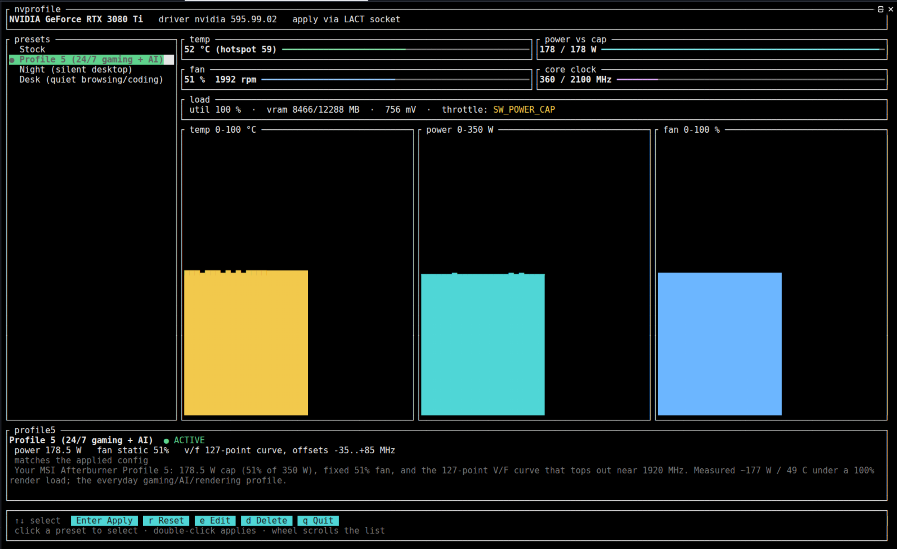

# nvprofile

Power, fan and V/F-curve profiles for NVIDIA GPUs on Linux, with a terminal UI and CLI.
It drives the [LACT](https://github.com/ilya-zlobintsev/LACT) daemon, so it works on
**Wayland with no X server and no Coolbits**.

Born from replacing an MSI Afterburner "Profile 5" (power cap + fixed fan + custom V/F curve)
on Ubuntu, where the stock driver fan curve made renders loud.



## Requirements

- Linux with the proprietary NVIDIA driver (NVML and NvAPI libraries; tested on 595.x, RTX 3080 Ti)
- [LACT](https://github.com/ilya-zlobintsev/LACT) 0.10+ with `lactd` running (`sudo systemctl enable --now lactd`)
- Your user in the daemon's admin group (`sudo` on Ubuntu) so the socket is usable without root
- Rust (stable) to build

## Install

```bash
git clone https://github.com/tzero86/nvprofile
cd nvprofile
cargo build --release
install -m 755 target/release/nvprofile ~/.local/bin/nvprofile
```

## Usage

```bash
nvprofile                  # interactive TUI
nvprofile status [--json]  # live stats + active preset
nvprofile presets          # list presets (active one marked)
nvprofile show night
nvprofile apply night      # add --dry-run to preview
nvprofile diff profile5    # compare applied config with a preset
nvprofile save my-preset   # snapshot current settings as a user preset
nvprofile delete my-preset
nvprofile reset            # back to stock (same as `apply stock`)
```

### TUI controls

Keys: `↑/↓` select, `Enter` apply, `r` reset to stock, `e` edit a copy (power/fan),
`s` save as user preset, `d` delete a user preset, `q` quit. Applying and deleting always ask
`[y/N]` first.

Mouse (any terminal with SGR mouse reporting; the keyboard works the same without it):

| Action | Effect |
|---|---|
| Click a preset | select it |
| Double-click a preset (or click it again within 400 ms) | apply it (opens the same `[y/N]` confirm as `Enter`) |
| Wheel over the preset list | move the selection (wheel elsewhere is ignored) |
| Footer buttons `Apply` `Reset` `Edit` `Delete` `Quit` | same as `Enter` `r` `e` `d` `q`, including confirm prompts |
| Confirm prompt: `Yes` / `No` buttons | same as `y` / any other key; clicks elsewhere are ignored while a prompt is open |
| Edit mode: click the power or fan row | select it |
| Edit mode: click `◀` / `▶`, or wheel over a row | adjust by the same step as `←` / `→` (power 5 W, fan 1 %) |
| Edit mode: `Save` / `Cancel` buttons | same as `s` / `Esc` |

Mouse reporting is switched off on quit, on panic, and while the sudo prompt is on screen.

## Built-in presets

| id | Power cap | Fan | Intended use |
|---|---|---|---|
| `stock` | driver default | driver auto | Reset |
| `profile5` | 178.5 W | static 51 % | 24/7 gaming and AI/rendering |
| `desk` | 155 W | curve 31 % → 70 %, zero-RPM below 45 °C | quiet browsing and coding |
| `night` | 130 W | curve 31 % → 70 %, zero-RPM below 50 °C | near-silent |

`profile5`, `desk` and `night` share a 127-point V/F offset curve captured from the original
Afterburner profile (caps near 1920 MHz). Values are starting points: tune them for your card.
Manual fan speed cannot go below ~30 % on many cards, so "zero-RPM" is LACT's switch back to the
driver's own fan control under the threshold.

Your own presets are YAML files in `~/.config/nvprofile/presets/`.

## How applying works

1. The engine reads the GPU's block from the daemon (`get_gpu_config`), overlays only the keys it
   owns, sends `set_gpu_config`, then `confirm_pending_config`. The daemon persists
   `/etc/lact/config.yaml` itself and re-applies it at boot. **No root, no password.**
2. If the socket is unusable, it falls back to staging a merged config and running
   `sudo install -m 644 <tmp> /etc/lact/config.yaml` (the front-end handles the prompt).
3. Each real apply backs up the previous config to `~/.local/state/nvprofile/backups/` (last 10 kept).

Recovery: `nvprofile reset`, or copy the newest backup over `/etc/lact/config.yaml`.

## Layout

| Crate | Purpose |
|---|---|
| [`nvprofile-engine`](crates/nvprofile-engine) | UI-agnostic library: presets, validation, config merge, LACT backend, mock backend. Types are `serde`-serializable, so a Tauri or web UI can consume it directly. |
| [`nvprofile`](crates/nvprofile) | CLI + ratatui TUI built on the engine. |

## Status and caveats

- Developed and tested against one machine (Ubuntu 26.04, RTX 3080 Ti). Other GPUs may expose
  different limits; presets are validated against the live card's limits before applying.
- The daemon write path (`set_gpu_config` / `confirm_pending_config`) follows LACT's master source;
  it is covered by tests against a fake daemon.
- Only GPU fans are controlled, not case or CPU fans.
- Changing power, clocks and fans is at your own risk.

## Development

```bash
cargo test    # 50 tests, no real daemon or /etc access
```

## License

MIT
